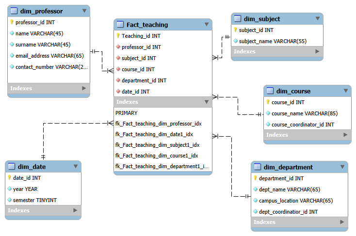

# Star Schema | Dimensional Modelling

**DIO Power BI Bootcamp · Dimensional Modelling Challenge**

For this challenge, I had to turn a relational database model into a star schema, focusing on professors and their teaching activities.

I decided to use **MySQL Workbench's EER Diagram** to design the model, as I was already familiar with the tool from my previous project.

## My Star Schema

  

## How I approached it

I started by thinking about what each row in my fact table should represent. Initially, I considered using a combination of professor and subject IDs as a composite primary key, but realised this wouldn't work if a professor taught the same subject in different semesters or courses.

I therefore decided that each row would represent **one professor teaching one subject, in one course, during one semester**, using a unique `Teaching_ID` as the primary key.

From there, I created five dimension tables:

- **Dim_Professor** – Professor details
- **Dim_Subject** – Subjects taught
- **Dim_Course** – Course information
- **Dim_Department** – Department information
- **Dim_Date** – Year and semester

One thing I had to consider was how to handle department information. Rather than repeating department names in the professor table, I connected both dimensions through the fact table. This also means that if a professor changes departments, their previous teaching assignments can still be associated with the correct department.

I kept the fact table simple, without numerical measures, as the purpose is to record teaching assignments that could later be counted and analysed.

## What I learned

This exercise helped me understand why **deciding the granularity of a fact table is so important before creating the relationships**.

I also got more practice with primary and foreign keys, one-to-many relationships and the difference between relational and dimensional modelling.

And, as usual, MySQL Workbench gave me a little troubleshooting practice! It automatically created duplicate foreign-key columns when I connected the tables, so I had to correct the mappings and remove the unnecessary columns.

## Project files

- `star_schema_model_DIOlab.mwb` – Editable MySQL Workbench model
- `star_schema_model_DIOlab.png` – Exported star schema diagram

---

*Created as part of my DIO Power BI Bootcamp.*
